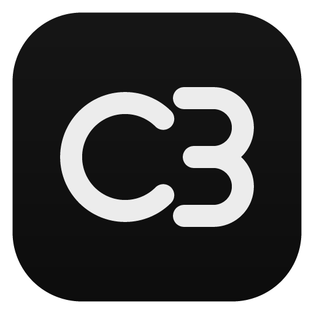
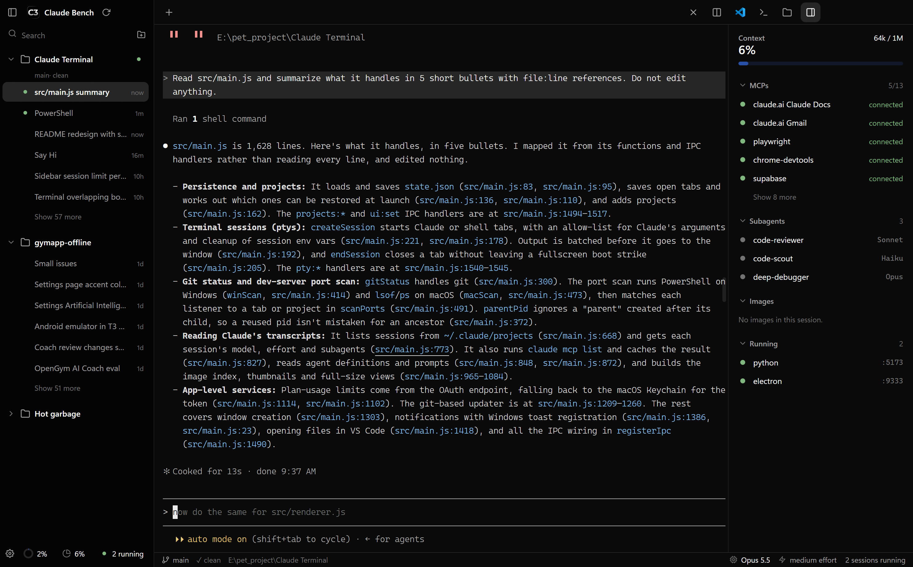
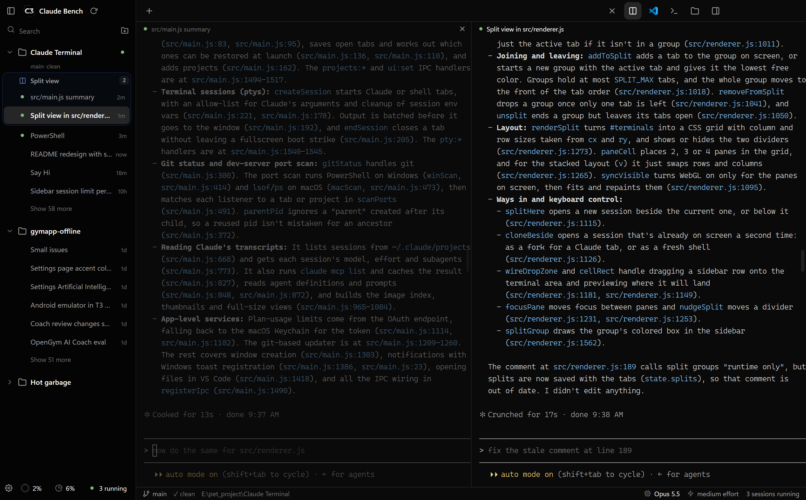
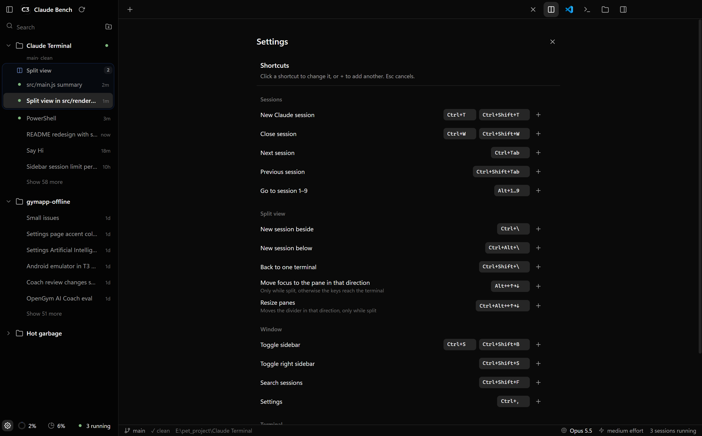

<p align="center">
  
</p>

<h1 align="center">Claude Bench</h1>

<p align="center">
  A desktop app for running several Claude Code sessions side by side.<br>
  Windows first, macOS best effort.
</p>

<p align="center">
  
</p>

Every tab is the real `claude` CLI in a real terminal, so slash commands, permissions, models and speed are exactly
what you get in a shell. Claude Bench only adds the things a terminal window doesn't have: a project sidebar, tabs,
split panes, git status and a list of the dev servers your sessions started.

## What it does

- **Projects and sessions.** Add a folder once, then start a session in it with one click. Past sessions are listed
  under each project by their title; click one to resume it, or right-click to fork it.
- **Tabs that come back.** Open sessions reopen on the next launch, resumed where they left off.
- **Split view.** Up to four sessions on screen at once. Drag a session from the sidebar onto the terminal, or press
  `Ctrl+\`. You can keep several splits around; each gets its own box in the sidebar.
- **Git at a glance.** Branch, changed files and ahead/behind for every project.
- **Session details.** Context usage, connected MCP servers, subagents and their prompts, and the images pasted into
  or read by the session.
- **Running servers.** Dev servers started from a session show up with their port. Click to copy the URL,
  Shift+click to open it.
- **Clickable file paths.** Ctrl+click `src/main.js:123` in Claude's output to open it in VS Code at that line.
  Images, videos, PDFs and other binary files open in their default app.
- **Notifications.** A background session tells you when it needs input or has finished a longer task.
- **Plan limits.** Session and weekly usage in the footer.

<p align="center">
  
</p>

## Install

You need [Node.js](https://nodejs.org), git, and the `claude` CLI installed and logged in.

```
git clone https://github.com/AalishMS/Claude-Bench.git
cd Claude-Bench
npm install
npm start
```

To use it as a normal app on Windows, build it and add shortcuts:

```
npm run package     # builds dist\win-unpacked\Claude Bench.exe
npm run shortcut    # Desktop and Start menu shortcuts
```

`Claude Bench.exe C:\some\folder` adds that folder as a project and opens a session in it.

### macOS

macOS works but isn't tested by the author. Install git with `xcode-select --install`, then:

```
npm install
npm start
npm run package:mac   # optional: dist/mac-*/Claude Bench.app, unsigned, for your own machine
```

Things that differ on a Mac:

- Shortcuts use `⌘` where the table below says `Ctrl`, and `⌘` instead of `Alt` (`⌘1`..`9`, `⌘` + arrows).
  `Ctrl+Tab` stays. Plain `Ctrl` is left to Claude Code, so `Ctrl+C` interrupts and `Ctrl+V` pastes images.
- Copy and paste are `⌘C` / `⌘V` or right-click. Option acts as Meta, so Claude's Option shortcuts work.
- Sessions use your login shell's PATH, so `claude` and `node` are found even when the app is opened from Finder.
- File links open at the right line if VS Code's `code` command is installed ("Shell Command: Install 'code' command
  in PATH"), otherwise VS Code opens the file without the line. Binary files open in their default app (`open`).
- The footer's plan limits read Claude Code's token from the Keychain. macOS may ask once for access.
- Notifications go through Notification Center. Allow them when asked (under `npm start` they show as Electron).

If something goes wrong:

| Problem | Fix |
| --- | --- |
| Electron missing after `npm install` | `node node_modules/electron/install.js` |
| Tabs fail with `posix_spawnp failed` | `chmod +x node_modules/@lydell/node-pty-darwin-*/spawn-helper` |
| "The app is damaged" | `codesign --force --deep -s - "dist/mac-arm64/Claude Bench.app"` |

## Updating

When the repo has new commits, a download icon appears next to the app name with a list of what changed. Click
Update.

- From `npm start`, the app pulls, runs `npm install` if needed, and restarts.
- From a built `.exe` or `.app`, it closes, pulls, rebuilds, and reopens with your tabs. On Windows you'll see a console
  window while it works.

If your local edits clash with the update, it stops and shows git's message. To do it by hand: close the app,
`git pull`, `npm run package`. Projects and settings live outside the repo, so they survive updates.

## Shortcuts

| Keys | Action |
| --- | --- |
| `Ctrl+T` / `Ctrl+W` | New session / close session |
| `Ctrl+Tab` / `Ctrl+Shift+Tab` | Next / previous session |
| `Alt+1`..`9` | Jump to a session |
| `Ctrl+\` / `Ctrl+Alt+\` | New session beside / below |
| `Ctrl+Shift+\` | Back to one terminal |
| `Alt+arrows` / `Ctrl+Alt+arrows` | Move focus / resize panes (while split) |
| `Ctrl+S` / `Ctrl+Shift+S` | Toggle left / right sidebar |
| `Ctrl+Shift+F` | Search sessions |
| `Ctrl+,` | Settings |

Every shortcut can be changed in Settings (the gear at the bottom left). The defaults stay clear of keys Claude Code
uses, except `Ctrl+T`, `Ctrl+S` and `Ctrl+W`. Drop files onto a terminal to paste their paths. `F12` opens DevTools.

<p align="center">
  
</p>

## How it's built

Electron, xterm.js and node-pty, with no bundler or framework.

- `src/main.js` handles windows, terminals, git, the port scan and saved state
- `src/renderer.js`, `index.html` and `styles.css` are the UI
- `src/preload.js` is the bridge between them
- `scripts/` has the shortcut creator and update helpers
- `assets/` has the logo: `icon-source.png` is the master, the rest are derived from it

State is saved in `%APPDATA%\claude-bench` on Windows and `~/Library/Application Support` on macOS.
